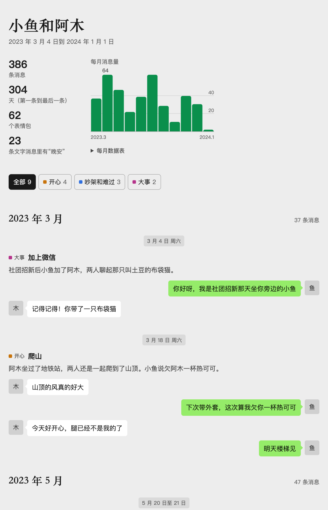

# wechat-memories · 微信回忆

用微信聊天记录做一个只存在你电脑上的回忆页面。Claude 把你和某个人的聊天从头读到尾，整理成按月排列的时间线：开心的、吵架的、大事都有，每句原话都和记录核对过。恋人、朋友、家人都可以。



*Turn your own WeChat history with someone into a private, single-file memory timeline. A Claude Code skill: reads the whole chat, writes dated events with verbatim quotes, and refuses to build the page if a quote can't be found in the record.*

## 快速开始

1. 按下一节把聊天记录导出成文件。
2. 安装 skill：

   ```bash
   git clone https://github.com/GuobaPei/wechat-memories.git ~/.claude/skills/wechat-memories
   ```

3. 对 Claude 说：

   > 用 ~/export/wechat_messages.json 里我和阿木的聊天记录做一个回忆页面

## 怎么读到聊天记录

微信把聊天记录加密存在你的电脑上，要先解密导出成文件。这个仓库不带解密代码，导出用开源工具 [chatlog-keeper](https://github.com/labazhou2024/chatlog-keeper)（MIT 协议）。它只处理你自己账号、你自己设备上的数据，全程在本地运行。

下面是 macOS 的步骤。命令在 Windows 和 Linux 上一样，系统相关的准备看[它的说明](https://github.com/labazhou2024/chatlog-keeper/blob/main/README.zh.md)。

### 准备

- 电脑版微信已登录你自己的账号。导出的只有这台电脑上有的记录，不全的话，先用微信自带的“聊天记录迁移与备份”把手机上的记录迁到电脑。
- Python 3.9 或更高，以及 Xcode Command Line Tools（`xcode-select --install`）。
- 在“系统设置 → 隐私与安全性 → 完全磁盘访问权限”里打开你用的终端，然后重启终端。

### 1. 安装 chatlog-keeper

```bash
git clone https://github.com/labazhou2024/chatlog-keeper.git
cd chatlog-keeper
python3 -m pip install .
```

### 2. 看看能不能读

```bash
python3 -m chatlog_keeper.cli probe
```

它会显示本机能导出什么、解密 key 拿到了没有。

### 3. 拿解密 key

多数情况下工具会自动取到，可以先做第 4 步。自动取不到时（新版微信常见）运行：

```bash
python3 -m chatlog_keeper.cli extract-key --source wechat
```

在 macOS 上，它可能会打开一个隔离的微信副本，你平时用的微信不会被改动：

1. 先从菜单正常退出微信，等它完全关闭。
2. 在副本窗口里点“进入微信”，需要的话在手机上确认。
3. 系统问能否访问其他 App 的数据时，选允许。

这个流程不需要关闭 SIP，也不需要管理员密码。如果有东西要你把系统密码输进终端或第三方界面，立刻停下。

### 4. 找到这个人的会话

```bash
python3 -m chatlog_keeper.cli directory --source wechat > directory.json
```

```bash
python3 -c "import json; [print(c['conversation_id'], c['message_count'], c['label']) for c in json.load(open('directory.json'))['conversations'] if '阿木' in (c['label'] or '')]"
```

把“阿木”换成对方的微信名或备注。这一步只读会话列表，不读消息内容，会打印会话 ID、消息条数和名字。

### 5. 导出全部聊天

```bash
python3 -m chatlog_keeper.cli wechat --days 3650 --conversation <会话ID> --out ./export
```

`--days` 是往回导出多少天，默认只有 7 天，所以要开够大。完成后会得到 `export/wechat_messages.json`，还有一份能直接打开看的 `export/wechat_messages.html`。

### 常见问题

- **`debug_copy_unsupported_client`：** 这个微信版本还没被支持。更新 chatlog-keeper 再试，它的文档不建议手动扩大版本白名单。
- **`daily_client_single_instance_conflict`：** 微信没有完全退出。从菜单退出后重试，不要强制退出。
- **拒绝访问：** 给终端打开完全磁盘访问权限，然后重启终端。
- **其他错误：** 看 chatlog-keeper 的 [macOS 说明](https://github.com/labazhou2024/chatlog-keeper/blob/main/docs/macos.zh.md)。

### 风险

- 只能导出你自己账号的数据，不要拿去读别人的聊天。
- 这类工具可能违反微信的服务条款，账号有被平台处理的风险。用之前读一下它的[免责声明](https://github.com/labazhou2024/chatlog-keeper/blob/main/DISCLAIMER.zh.md)，自己判断。

## Claude 怎么读这些记录

导出文件可能有几万条，只看开头或结尾会误解前因后果，所以 skill 要求全部读完：

1. `scripts/make_transcript.py` 把导出压成按天排列的文字稿，分成若干段，每段大约 7 万字。
2. 每段里插了随机校验码。Claude 读完一段写一份笔记，把校验码抄进去，脚本再检查，缺了就要重读。
3. 聊天很长时，每段交给一个子 agent 去读。
4. Claude 根据笔记写事件：日期、经过、最多 4 句原话。
5. `scripts/build_page.py` 把每句原话按说话人和日期回到导出里查，查不到就不生成页面。

记录里读不到通话内容（只有时长）、见面时的事、图片、语音、表情包的画面和撤回的消息。这些不会被编出来，页面底部也会写明。

## 隐私

- 脚本只用 Python 标准库，不联网。页面是单文件，不加载任何外部资源。
- **Claude 要读聊天内容，这些文字会发给你使用的 AI 服务。** 里面也有对方说的话，请自己判断。
- 敏感信息扫描：长数字、密码、验证码、外链，还有你列出的真名，一旦出现就不生成页面。
- 工作目录不要放在 git 仓库或网盘里。
- 这个仓库不含真实聊天记录，`examples/` 里的人和事都是虚构的。

## 为什么不带解密代码

微信更新后，解密流程可能要跟着调整，交给专门维护的项目更可靠。这类代码还牵涉账号风险和平台的下架要求，分开放，这个 skill 也能配合任何导出工具使用。别的工具导出的记录，转成 `SKILL.md` 里写的格式就行。

## 不用 Claude 先试试

```bash
python3 scripts/build_page.py --messages examples/messages.json --events examples/events.json \
  --me 小鱼 --them 阿木 --count-word 晚安 --out /tmp/wechat-memories-example.html
```

```bash
python3 tests/test_skill.py
```

## License

[MIT](LICENSE)
